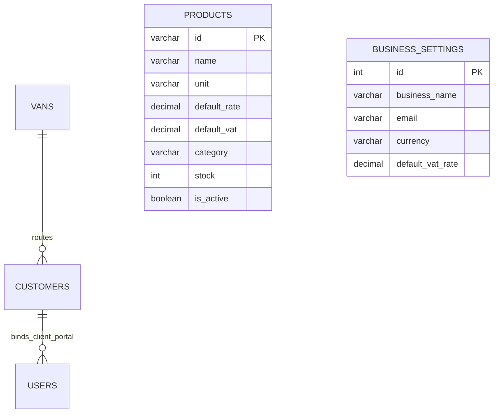

# LedgerFlow Database Documentation

This document covers database configuration, XAMPP MySQL integration, Prisma ORM schema definitions, and migration tracking for the **LedgerFlow Invoice System** backend.

---

## 1. Database Architecture Overview

- **Engine:** MySQL (via XAMPP Community Server on `localhost:3306`)
- **Database Name:** `ledgerflow_db`
- **ORM:** Prisma ORM (`@prisma/client` v6.4.1) with native `mysql` provider
- **Character Set / Collation:** `utf8mb4` / `utf8mb4_unicode_ci`

---

## 2. Applied Migrations

| Migration Name | Applied At | Status | Description |
|---|---|---|---|
| `20261019063216_init_phase2_auth_core` | 2026-10-19 | **Applied** | Creates core tables: `vans`, `customers`, `users`, `business_settings`, indexes, and foreign keys. |
| `20261019064310_add_products_table` | 2026-10-19 | **Applied** | Creates wholesale `products` table with pricing, category, and VAT indexes; adds `idx_customers_status` index on `customers`. |
| `20261019070708_add_invoices_and_payments` | 2026-10-19 | **Applied** | Creates wholesale invoicing and payments engine: `invoice_sequences`, `invoices`, `invoice_items`, `payments`, and `payment_allocations`. |
| `20261019073420_add_orders_and_mileage` | 2026-10-19 | **Applied** | Creates daily operations and fleet models: `orders`, `order_items`, `mileage_records`, and `vehicle_expenses` with foreign keys and indexes. |

---

## 3. Database Schema Specification (Phase 3)

### Table 1: `vans`
Stores delivery fleet vehicles used for daily customer order dispatching and route grouping.
- `id` (`VARCHAR(50)`): Primary key (e.g. `'van1'`, `'van2'`, `'van3'`).
- `name` (`VARCHAR(100)`): Display name (e.g. `'Van 1'`).
- `vehicle` (`VARCHAR(150)`): Vehicle model/registration (e.g. `'Ford Transit - LN72 XRT'`).
- `is_active` (`BOOLEAN`): Active route flag (`DEFAULT TRUE`).
- `created_at` (`DATETIME(3)`): Record creation timestamp.
- `updated_at` (`DATETIME(3)`): Last update timestamp.

### Table 2: `customers`
Stores wholesale buyers, credit terms, contact information, opening balances, and delivery van routing.
- `id` (`VARCHAR(50)`): Primary key (e.g. `'CUST-001'`).
- `name` (`VARCHAR(255)`): Business name (e.g. `'Green Valley Restaurant'`).
- `contact_person` (`VARCHAR(255)`): Main contact person name.
- `email` (`VARCHAR(255)`): Accounts / ordering email.
- `phone` (`VARCHAR(50)`): Telephone contact.
- `address` (`TEXT`): Delivery and billing address.
- `vat_number` (`VARCHAR(50)`): Client UK VAT registration number.
- `payment_terms` (`INT`): Payment credit terms in days (`DEFAULT 14`).
- `status` (`VARCHAR(50)`): Customer account status (`'Active'`, `'Inactive'`, `'Suspended'`).
- `opening_balance` (`DECIMAL(12, 2)`): Historical opening balance carried forward (`DEFAULT 0.00`). Cannot be negative.
- `notes` (`TEXT`): Delivery instructions and account notes.
- `van_id` (`VARCHAR(50)`): Foreign key referencing `vans(id)` (`ON DELETE SET NULL`).
- `created_at` (`DATETIME(3)`): Record creation timestamp.
- `updated_at` (`DATETIME(3)`): Last update timestamp.
- **Indexes:** `idx_customers_van_id (van_id)`, `idx_customers_status (status)`.

### Table 3: `products`
Wholesale produce catalog with standard units, default sales pricing, stock quantities, and UK standard / zero-rated VAT categories.
- `id` (`VARCHAR(50)`): Primary key SKU (e.g. `'PROD-001'`).
- `name` (`VARCHAR(255)`): Product item name (e.g. `'Vine Tomatoes'`).
- `unit` (`VARCHAR(50)`): Packaging unit (e.g. `'kg'`, `'units'`, `'bunches'`, `'tins'`, `'boxes (18ct)'`).
- `default_rate` (`DECIMAL(10, 2)`): Standard wholesale price rate (`DEFAULT 0.00`).
- `default_vat` (`DECIMAL(5, 2)`): Standard VAT rate percentage: `0.00` for zero-rated produce, `20.00` for standard rate items (`DEFAULT 0.00`).
- `category` (`VARCHAR(100)`): Product classification (e.g. `'Produce'`, `'Salads'`, `'Root Veg'`, `'Herbs'`, `'Pantry'`).
- `stock` (`INT`): On-hand inventory count (`DEFAULT 0`).
- `is_active` (`BOOLEAN`): Product availability status (`DEFAULT TRUE`).
- `created_at` (`DATETIME(3)`): Record creation timestamp.
- `updated_at` (`DATETIME(3)`): Last update timestamp.
- **Indexes:** `idx_products_category (category)`, `idx_products_is_active (is_active)`.

### Table 4: `users`
Stores authenticated users across Admin/Owner, Accountant, and Customer roles.
- `id` (`VARCHAR(36)`): Primary key UUID.
- `email` (`VARCHAR(255)`): Unique user login email.
- `password_hash` (`VARCHAR(255)`): Salted bcrypt password hash (work factor: 12).
- `role` (`VARCHAR(50)`): Access tier (`'admin'`, `'accountant'`, `'customer'`).
- `name` (`VARCHAR(255)`): Full user name.
- `title` (`VARCHAR(100)`): Organizational title (e.g. `'Business Owner / Admin'`).
- `customer_id` (`VARCHAR(50)`): Foreign key referencing `customers(id)` (`ON DELETE SET NULL`). Strictly required for customer role accounts to guarantee multi-tenant account isolation.
- `is_active` (`BOOLEAN`): Account active status (`DEFAULT TRUE`).
- `last_login_at` (`DATETIME(3)`): Timestamp of most recent authentication.
- `created_at` (`DATETIME(3)`): Account creation timestamp.
- `updated_at` (`DATETIME(3)`): Last update timestamp.
- **Indexes:** `users_email_key (email UNIQUE)`, `idx_users_role (role)`, `idx_users_customer_id (customer_id)`.

### Table 5: `business_settings`
Singleton configuration record (ID: 1) storing company profile, banking, and VAT details.
- `id` (`INT`): Primary key (`DEFAULT 1`).
- `business_name` (`VARCHAR(255)`): Registered company legal name.
- `trading_name` (`VARCHAR(255)`): Trading style.
- `email` (`VARCHAR(255)`): Official company accounts email.
- `phone` (`VARCHAR(50)`): Primary business telephone.
- `address` (`TEXT`): Physical warehouse address.
- `vat_number` (`VARCHAR(50)`): HMRC VAT registration number.
- `company_number` (`VARCHAR(50)`): Companies House number.
- `currency` (`VARCHAR(10)`): Base currency (`'GBP'`).
- `currency_symbol` (`VARCHAR(5)`): Currency symbol (`'£'`).
- `invoice_prefix` (`VARCHAR(20)`): Invoice numbering prefix (`'INV-2026-'`).
- `next_invoice_number` (`INT`): Next sequence counter.
- `default_payment_terms` (`INT`): Default payment terms (`14`).
- `default_vat_rate` (`DECIMAL(5, 2)`): Standard UK VAT rate (`20.00`).
- `bank_name` (`VARCHAR(100)`): Remittance bank.
- `account_name` (`VARCHAR(150)`): Bank account name.
- `sort_code` (`VARCHAR(20)`): Bank sort code.
- `account_number` (`VARCHAR(30)`): Bank account number.
- `iban` (`VARCHAR(50)`): International Bank Account Number.
- `square_connected` (`BOOLEAN`): Square POS connection status.
- `square_merchant_id` (`VARCHAR(100)`): Square live merchant ID.
- `whatsapp_status` (`VARCHAR(50)`): WhatsApp integration state.
- `whatsapp_phone` (`VARCHAR(50)`): Dispatch WhatsApp number.
- `notes_footer` (`TEXT`): Default invoice legal & payment notes footer.
- `created_at` (`DATETIME(3)`): Timestamp.
- `updated_at` (`DATETIME(3)`): Timestamp.

### Table 6: `invoice_sequences`
Concurrency-safe atomic numbering counters for invoices and payments.
- `prefix` (`VARCHAR(20)`): Primary key prefix string (e.g. `'INV-2026-'`, `'PAY-2026-'`).
- `next_number` (`INT`): Next sequence counter incremented atomically inside DB transactions.
- `updated_at` (`DATETIME(3)`): Timestamp.

### Table 7: `invoices`
Wholesale sales invoices issued to customers.
- `id` (`VARCHAR(36)`): Primary key cuid.
- `invoice_number` (`VARCHAR(50)`): Unique sequential invoice number (`INV-2026-xxx`).
- `customer_id` (`VARCHAR(50)`): Foreign key referencing `customers(id)` (`ON DELETE RESTRICT`).
- `issue_date` (`DATE`): Date of invoice issue.
- `due_date` (`DATE`): Payment due date based on customer credit terms.
- `reference` (`VARCHAR(100)`): Customer purchase order or delivery reference.
- `status` (`VARCHAR(50)`): Lifecycle status (`'Draft'`, `'Sent'`, `'Partially Paid'`, `'Paid'`, `'Overdue'`, `'Void'`).
- `subtotal` (`DECIMAL(12, 2)`): Net sum of invoice lines before VAT.
- `vat_amount` (`DECIMAL(12, 2)`): Computed VAT total.
- `discount_amount` (`DECIMAL(12, 2)`): Optional discount deduction (`DEFAULT 0.00`).
- `total` (`DECIMAL(12, 2)`): Gross invoice total payable (`subtotal + vat_amount - discount_amount`).
- `amount_paid` (`DECIMAL(12, 2)`): Settled amount via payment allocations.
- `balance_due` (`DECIMAL(12, 2)`): Remaining outstanding balance (`total - amount_paid`).
- `notes` (`TEXT`): Payment terms or remittance instructions.
- `void_reason` (`VARCHAR(255)`): Audit trail explanation if invoice is voided.
- `voided_at` (`DATETIME(3)`): Timestamp of voiding action.
- `created_at` (`DATETIME(3)`): Record creation timestamp.
- `updated_at` (`DATETIME(3)`): Last update timestamp.
- **Indexes:** `invoices_invoice_number_key (UNIQUE)`, `idx_invoices_customer_id (customer_id)`, `idx_invoices_status (status)`, `idx_invoices_issue_date (issue_date)`.

### Table 8: `invoice_items`
Line items preserving historical price and VAT snapshots.
- `id` (`VARCHAR(36)`): Primary key cuid.
- `invoice_id` (`VARCHAR(36)`): Foreign key referencing `invoices(id)` (`ON DELETE CASCADE`).
- `product_id` (`VARCHAR(50)`): Foreign key referencing `products(id)` (`ON DELETE RESTRICT`).
- `description` (`VARCHAR(255)`): Immutable item description snapshot.
- `quantity` (`DECIMAL(10, 2)`): Quantity ordered.
- `unit` (`VARCHAR(50)`): Unit of measure snapshot.
- `unit_price` (`DECIMAL(10, 2)`): Historical unit price snapshot (future product price changes do not alter this).
- `vat_rate` (`DECIMAL(5, 2)`): Historical VAT rate percentage snapshot (e.g. `0.00`, `20.00`).
- `vat_amount` (`DECIMAL(10, 2)`): Line VAT amount.
- `subtotal` (`DECIMAL(12, 2)`): Line net total (`quantity * unit_price`).
- `total` (`DECIMAL(12, 2)`): Line gross total (`subtotal + vat_amount`).
- `created_at` (`DATETIME(3)`): Timestamp.
- **Indexes:** `idx_invoice_items_invoice_id (invoice_id)`, `idx_invoice_items_product_id (product_id)`.

### Table 9: `payments`
Customer payments, remittances, and on-account credits.
- `id` (`VARCHAR(36)`): Primary key cuid.
- `payment_number` (`VARCHAR(50)`): Unique sequential payment number (`PAY-2026-xxx`).
- `customer_id` (`VARCHAR(50)`): Foreign key referencing `customers(id)` (`ON DELETE RESTRICT`).
- `amount` (`DECIMAL(12, 2)`): Total remitted payment amount.
- `unallocated_amount` (`DECIMAL(12, 2)`): Credit on account remaining after invoice allocations.
- `payment_date` (`DATE`): Date payment was received.
- `payment_method` (`VARCHAR(50)`): Method (`'Bank Transfer'`, `'Cash'`, `'Card'`, `'Square'`, `'Cheque'`).
- `reference` (`VARCHAR(100)`): Bank transfer or card transaction reference.
- `notes` (`TEXT`): Additional payment notes.
- `status` (`VARCHAR(50)`): `'Completed'` or `'Voided'`.
- `idempotency_key` (`VARCHAR(100)`): Optional idempotency token preventing duplicate charges.
- `void_reason` (`VARCHAR(255)`): Reversal audit reason.
- `voided_at` (`DATETIME(3)`): Reversal timestamp.
- `created_at` (`DATETIME(3)`): Timestamp.
- `updated_at` (`DATETIME(3)`): Timestamp.
- **Indexes:** `payments_payment_number_key (UNIQUE)`, `payments_idempotency_key_key (UNIQUE)`, `idx_payments_customer_id (customer_id)`, `idx_payments_payment_date (payment_date)`, `idx_payments_status (status)`.

### Table 10: `payment_allocations`
Junction table linking payments to invoices with atomic balance adjustments.
- `id` (`VARCHAR(36)`): Primary key cuid.
- `payment_id` (`VARCHAR(36)`): Foreign key referencing `payments(id)` (`ON DELETE CASCADE`).
- `invoice_id` (`VARCHAR(36)`): Foreign key referencing `invoices(id)` (`ON DELETE RESTRICT`).
- `amount` (`DECIMAL(12, 2)`): Amount allocated to this specific invoice.
- `created_at` (`DATETIME(3)`): Timestamp.
- **Indexes:** `idx_payment_allocations_payment_id (payment_id)`, `idx_payment_allocations_invoice_id (invoice_id)`.

### Table 11: `orders`
Daily customer wholesale delivery orders.
- `id` (`VARCHAR(36)`): Primary key cuid.
- `order_number` (`VARCHAR(50)`): Unique sequential order number (`ORD-YYYY-MM-DD-xx`).
- `customer_id` (`VARCHAR(50)`): Foreign key referencing `customers(id)` (`ON DELETE RESTRICT`).
- `van_id` (`VARCHAR(50)`): Optional delivery route foreign key referencing `vans(id)` (`ON DELETE SET NULL`). Null indicates unassigned van.
- `order_date` (`DATE`): Delivery target calendar date.
- `status` (`VARCHAR(50)`): Order lifecycle state (`'Draft'`, `'Confirmed'`, `'Invoiced'`, `'Cancelled'`). Default `'Confirmed'`.
- `notes` (`TEXT`): Customer delivery instructions and dispatch notes.
- `created_at` (`DATETIME(3)`): Timestamp.
- `updated_at` (`DATETIME(3)`): Timestamp.
- **Indexes:** `orders_order_number_key (UNIQUE)`, `idx_orders_customer_id (customer_id)`, `idx_orders_order_date (order_date)`, `idx_orders_van_id (van_id)`, `idx_orders_status (status)`.

### Table 12: `order_items`
Individual product lines on daily orders preserving item name, unit, and agreed wholesale unit pricing snapshots.
- `id` (`VARCHAR(36)`): Primary key cuid.
- `order_id` (`VARCHAR(36)`): Foreign key referencing `orders(id)` (`ON DELETE CASCADE`).
- `product_id` (`VARCHAR(50)`): Optional catalog reference referencing `products(id)` (`ON DELETE RESTRICT`).
- `name` (`VARCHAR(255)`): Historical product name snapshot.
- `quantity` (`DECIMAL(10, 2)`): Ordered product quantity.
- `unit` (`VARCHAR(50)`): Packaging unit snapshot (e.g. `'kg'`, `'units'`).
- `unit_price` (`DECIMAL(10, 2)`): Agreed unit price.
- `created_at` (`DATETIME(3)`): Timestamp.
- **Indexes:** `idx_order_items_order_id (order_id)`, `idx_order_items_product_id (product_id)`.

### Table 13: `mileage_records`
Vehicle distance tracking records with odometer validation.
- `id` (`VARCHAR(36)`): Primary key cuid.
- `mileage_number` (`VARCHAR(50)`): Unique sequential mileage identifier (`MIL-YYYY-xxx`).
- `van_id` (`VARCHAR(50)`): Optional van reference referencing `vans(id)` (`ON DELETE SET NULL`).
- `vehicle` (`VARCHAR(150)`): Snapshot description/registration of vehicle.
- `date` (`DATE`): Journey date.
- `start_mileage` (`DECIMAL(10, 1)`): Beginning odometer reading.
- `end_mileage` (`DECIMAL(10, 1)`): Ending odometer reading (`end_mileage > start_mileage`).
- `distance` (`DECIMAL(10, 1)`): Derived distance (`end_mileage - start_mileage`).
- `distance_unit` (`VARCHAR(20)`): Distance unit (`'miles'`, `'km'`).
- `purpose` (`VARCHAR(255)`): Business travel justification.
- `rate` (`DECIMAL(6, 2)`): Approved mileage rate (e.g. `0.45`).
- `estimated_expense` (`DECIMAL(10, 2)`): Reimbursable expense amount (`distance * rate`).
- `recorded_in_expenses` (`BOOLEAN`): True if journey has been logged to expense ledger (`DEFAULT FALSE`).
- `notes` (`TEXT`): Route details or odometer adjustment authorization notes.
- `created_at` (`DATETIME(3)`): Timestamp.
- `updated_at` (`DATETIME(3)`): Timestamp.
- **Indexes:** `mileage_records_mileage_number_key (UNIQUE)`, `idx_mileage_van_id (van_id)`, `idx_mileage_date (date)`.

### Table 14: `vehicle_expenses`
Vehicle-specific operational expenditures and converted mileage claims.
- `id` (`VARCHAR(36)`): Primary key cuid.
- `expense_number` (`VARCHAR(50)`): Unique sequential expense identifier (`EXP-YYYY-xxx`).
- `van_id` (`VARCHAR(50)`): Optional van reference referencing `vans(id)` (`ON DELETE SET NULL`).
- `vehicle` (`VARCHAR(150)`): Target vehicle snapshot.
- `mileage_id` (`VARCHAR(36)`): Optional link referencing `mileage_records(id)` (`ON DELETE SET NULL`).
- `date` (`DATE`): Expense incurred date.
- `category` (`VARCHAR(100)`): Expense category (`'Fuel'`, `'Maintenance'`, `'Tolls'`, `'Insurance'`, `'Vehicle & Travel'`, `'Other'`).
- `description` (`VARCHAR(255)`): Itemized expense description.
- `amount` (`DECIMAL(10, 2)`): Decimal monetary amount.
- `status` (`VARCHAR(50)`): Expense state (`'Recorded'`, `'Void'`).
- `void_reason` (`VARCHAR(255)`): Audit trail explanation if voided.
- `voided_at` (`DATETIME(3)`): Timestamp of voiding action.
- `notes` (`TEXT`): Receipt or claim notes.
- `created_at` (`DATETIME(3)`): Timestamp.
- `updated_at` (`DATETIME(3)`): Timestamp.
- **Indexes:** `vehicle_expenses_expense_number_key (UNIQUE)`, `idx_vehicle_expenses_van_id (van_id)`, `idx_vehicle_expenses_date (date)`, `idx_vehicle_expenses_category (category)`, `idx_vehicle_expenses_mileage_id (mileage_id)`.

---

## 4. Safe Deletion & Referential Integrity Policy

1. **Customers:**
   - Soft-delete by default (`status = 'Inactive'`).
   - Hard deletion (`?hard=true`) is blocked if the customer has linked user login accounts (`409 Conflict: CUSTOMER_HAS_LINKED_USERS`), historical financial records (`409 Conflict: CUSTOMER_HAS_FINANCIAL_RECORDS`), or active orders.
2. **Delivery Vans:**
   - Cannot be deleted if customers are currently assigned to that delivery route (`409 Conflict: VAN_HAS_ASSIGNED_CUSTOMERS`). Customers must be reassigned first.
3. **Products:**
   - Soft-deactivate by default (`is_active = false`), preserving historical quotation and catalog integrity.
   - Hard deletion (`?hard=true`) is blocked if the product is referenced in historical invoice line items or order items.
4. **Daily Orders:**
   - Active orders (`Confirmed`, `Invoiced`) cannot be hard deleted.
   - Orders must be cancelled via `POST /api/v1/orders/:id/cancel` according to documented lifecycle rules. Cancelled orders contribute 0 demand to wholesale procurement aggregation.
   - Once converted to an invoice, orders are locked and cannot be edited or cancelled.
   - Draft or cancelled orders may be safely removed by an administrator.
5. **Mileage & Vehicle Expenses:**
   - Odometer readings require `end_mileage > start_mileage` and non-negative values. Start mileage less than the vehicle's last recorded odometer reading is rejected unless explicit `allowCorrection=true` authorization is provided.
   - Posting a trip to expenses atomically creates a `VehicleExpense` record and locks the mileage entry against duplicate claims.
   - Voiding an expense via `POST /api/v1/mileage/expenses/:id/void` preserves full audit history (`status = 'Void'`) and safely releases any linked mileage record.
6. **Invoices & Payments:**
   - Draft invoices with zero payment allocations may be safely deleted.
   - Finalized invoices cannot be deleted; they must be voided with an audit reason, safely reversing allocations. Payments cannot be hard deleted; they must be voided to atomically restore invoice balances.

